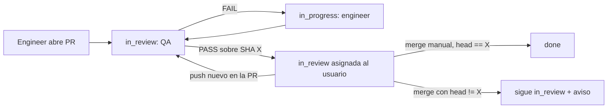

# QA PASS ligado al commit y cierre al mergear

Estado: estudio, sin implementación. Base de código: `paperclip-stable-auto` en
`379f65afd` (incluye upstream `v2026.1005.0`).

Nota 2026-10-25: las referencias singulares a `qaEvidence.handoff` de este estudio son históricas. El contrato actual usa `QaReviewEvidenceV2` con `handoffs[]`, una entrada y SHA revisado por cada PR abierta; omitir una PR rechaza el PASS. Véase `docs/guides/execution-policy.md`.

## Objetivo

Flujo para todas las tareas de código de la compañía:

- El merge lo hace siempre el usuario a mano desde la PR publicada por Paperclip.
- `done` significa «mergeado en la rama base», no «QA aprobado».
- Un PASS solo vale para el SHA revisado.

## Incidente de partida: NSS-699 / PR #15 (`nosolosoft/pathtime`)

| UTC | Hecho |
|---|---|
| 07/10 11:12 | QA FAIL sobre `78dbb1e` |
| 07/10 15:51 | QA FAIL sobre `18b0efe` (criterio 4: inundación de buzón) |
| 07/10 16:04 | Engineer sube `28528a3`; NSS-699 → `blocked` por NSS-701; QA no revisa |
| 08/10 19:29–19:40 | Usuario sube `c30f8aa`, `e740f38`, `49fa9c8`, `3f86718` |
| 09/10 11:18 | Merge de `main` en la rama (`5784f0c`) |
| 09/10 11:36 | PR #15 mergeada con NSS-699 en `blocked` y último veredicto FAIL |
| 09/10 14:26 | Comentario en NSS-701: el criterio 4 se mueve a NSS-701 |
| 09/10 14:26 | PATCH del board: quita blocker y pone `in_review` → wake de QA |
| 09/10 14:28 | QA PASS sobre `main` (`53d5fb8`) → `done` |

Conclusiones:

- Se mergearon cinco commits que ningún QA revisó. Nada en la PR lo indicaba.
- El último veredicto era FAIL; el PASS llegó después del merge.
- La reducción de alcance consta solo en un comentario de NSS-701. La
  descripción de NSS-699 sigue con el criterio 4 sin marcar.
- La relación real era «NSS-699 bloqueada por NSS-701»; el texto de NSS-701
  declara la dependencia inversa sin relación. Paperclip no lo detecta.
- `pathtime` es privado en plan gratuito: la API de branch protection y
  rulesets responde 403. No se puede exigir un check en GitHub.

## Qué existe hoy

| Pieza | Evidencia | Uso para el objetivo |
|---|---|---|
| `qaPolicy` por proyecto (`final`) | `server/src/services/issue-execution-policy.ts` `buildFinalQaExecutionPolicy` | Opptests y PathTimes usan `final` con OMP QA; EyeZoom usa `staged`. |
| PASS final → `done` y sin asignado | `server/src/routes/issues.ts` `applyDefaultQaDispositionRouting` | Es justo lo que hay que cambiar. |
| Etapa `approval` con participante usuario | `issue-execution-policy.ts` `buildPendingStagePatch`, `patchForPrincipal` | Tras pasar la etapa anterior, deja `in_review` y `assigneeUserId`. El usuario aprueba con PATCH `done` + comentario. |
| `qaEvidence` exige que review sea la última etapa | `routes/issues.ts` `resolveQaEvidenceForDecision` | Impide hoy combinar QA final con una etapa de aprobación posterior. |
| `qaEvidence.handoff` = `{kind,id,url}`, esquema `.strict()` | `packages/shared/src/validators/project.ts` `qaReviewEvidenceV1Schema` | No hay sitio para el SHA. |
| `headSha` en metadatos del work product PR | `server/src/services/github-ci-recovery.ts` | Existe, en JSON libre. |
| Eventos de PR (`merged`, `headSha`) | `server/src/services/github-connection-events.ts` | Llegan solo vía Paperclip Cloud connector. Esta instancia no está enrolada (`secrets/` sin fichero de enrolamiento): hoy no llega ningún evento. Al mergear solo se resuelven confirmaciones «Merge PR?». |
| Check runs en GitHub | `server/src/services/chat-github-checks.ts` | Ligado a revisiones de chat y al token del bot de Cloud. |
| Defaults de compañía para QA/etapas | — | No existen. Solo `projects.qaPolicy`. |

## Diseño propuesto

### 1. Etapa de merge tras QA final

Añadir a `qaPolicy` un campo opcional, p. ej.
`mergeApproverUserId`.

- `buildFinalQaExecutionPolicy` añade una etapa `approval` con ese usuario
  después de la etapa review de QA.
- `resolveQaEvidenceForDecision` acepta evidencia en la última etapa de tipo
  review, no solo en la última etapa absoluta.
- `applyDefaultQaDispositionRouting`: PASS con etapa de merge pendiente →
  `in_review`, `assigneeUserId` = aprobador, sin wake de agente.
- `validateProjectQaPolicy` valida que el usuario es miembro de la compañía.

Sin cambios en estados ni en tablas: reutiliza la máquina de etapas.

### 2. PASS ligado al SHA

- `qaEvidence.handoff.headSha`: obligatorio cuando `handoff.kind` es una PR.
- El servidor rechaza el PASS si el work product PR tiene `metadata.headSha`
  distinto.
- La skill/instrucciones de OMP QA rellenan el SHA revisado.
- `issue_execution_decisions.evidence` ya persiste la evidencia: no hace falta
  migración.

### 3. Observar la PR: merge y pushes

Sin Cloud connector, los eventos no llegan. Opciones:

| Opción | Pros | Contras |
|---|---|---|
| A. Enrolar la instancia en Paperclip Cloud e instalar la GitHub App | Usa el camino upstream; eventos casi en tiempo real | Dependencia externa; hay que añadir manejo de `synchronize` y de cierre de tarea |
| B. Sondeo local con token GitHub (secreto de compañía) para tareas en etapa de merge | Sin dependencias externas; solo las tareas en espera | Desarrollo propio; latencia del intervalo |
| C. Cierre manual: el usuario pasa a `done` tras mergear | Cero desarrollo | No detecta commits nuevos ni merges con head distinto |

Comportamiento común de A y B:

- PR `merged` y head == SHA del PASS → avanza la etapa de merge a `done`
  como actor de sistema, con actividad.
- PR `merged` y head != SHA del PASS → no cierra; comentario y acción de
  recuperación visible con los commits no revisados.
- Push nuevo antes del merge → invalida el PASS: vuelve a la etapa de QA
  (`in_review` asignada a QA, con wake).
- PR cerrada sin merge → `in_review` asignada al usuario con aviso.

Recomendación: fase 1 con la opción C, fase 2 con B. A cuando haya motivo para
depender de Cloud.

### 4. Señal en la página de la PR

Publicar un commit status `paperclip/qa` en cada veredicto y en cada cambio de
head: `success` con PASS sobre ese SHA, `failure` con FAIL, `pending` si no hay
veredicto para el head actual. En repos privados gratuitos el status se muestra
aunque no pueda exigirse [INFERENCIA: verificar contra `pathtime`]. Requiere el
mismo token que la opción B.

### 5. Ámbito «todos los proyectos»

No hay default de compañía. Opciones:

- Configurar `qaPolicy` en cada proyecto (hoy son tres) y añadirlo al alta de
  proyectos nuevos.
- Añadir un default de compañía que los proyectos hereden. Es un cambio de
  contrato en db/shared/server/ui.

Recomendación: por proyecto en fase 1.

## Otros casos del incidente

| Caso | Hoy | Propuesta |
|---|---|---|
| Dependencia en texto contraria a la relación | El rechazo de ciclos (`assertNoBlockingCycles`) mira solo relaciones; las menciones (`issue_reference_mentions`) no se cruzan | Aviso en la tarea cuando la sección «Dependencias» menciona una tarea sin relación de bloqueo, o con la relación inversa |
| Reducción de alcance tras FAIL | Solo receipt de 200 caracteres si se edita la descripción; nada si se hace con un comentario en otra tarea | Exigir que el recorte quede en la tarea afectada: criterios editados o `request_confirmation` resuelta en ella antes del PASS |
| PATCH del board que despierta agentes | Wakes post-commit; claves como `wake:false` se descartan en silencio | Campo explícito para no despertar en PATCH de board; mientras tanto, pausa de árbol (tree hold) y liberar sin `wakeAgents` |
| Merge con FAIL vigente | Sin señal en la PR | Cubierto por 4 y por la etapa de merge |

## Fases

1. `qaPolicy.mergeApproverUserId` + `headSha` en `qaEvidence` + actualización
   de la skill de QA. Cierre manual tras merge.
2. Sondeo de PRs en etapa de merge + commit status `paperclip/qa`.
3. Avisos de dependencias en texto, recorte de alcance y PATCH sin wake.

## Decisiones abiertas

- Token GitHub para fase 2: PAT de usuario o GitHub App propia.
- ¿Default de compañía para `qaPolicy`, o basta por proyecto?
- Intervalo de sondeo y límite de tareas observadas.
- Comportamiento si el usuario cierra a mano una tarea cuya PR no está
  mergeada.
